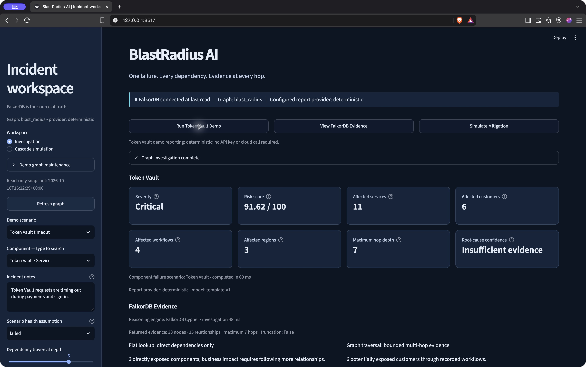
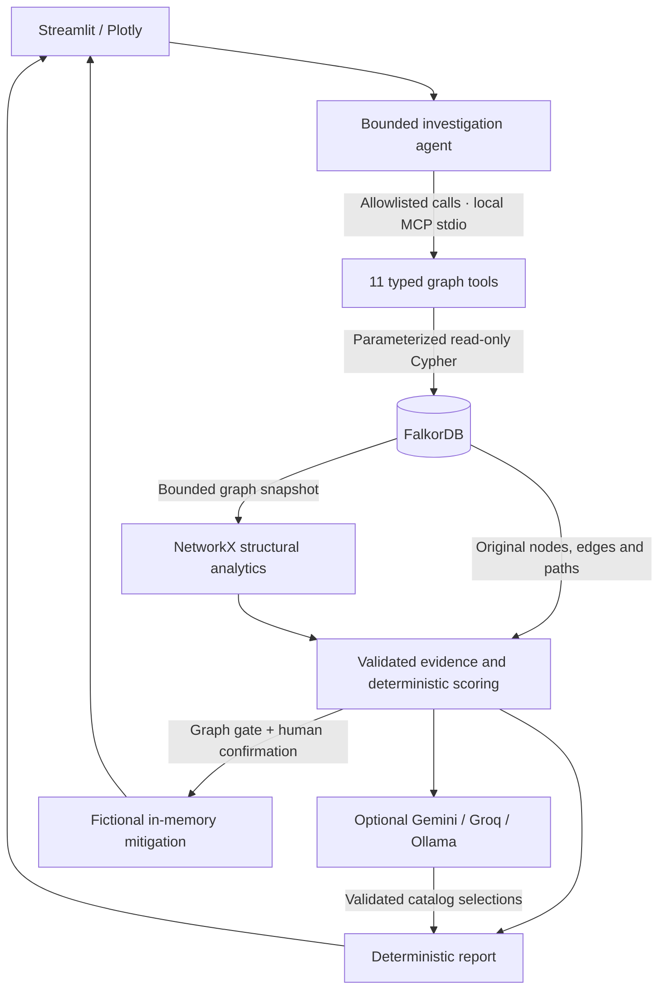

# BlastRadius AI

**Trace a cloud failure from one dependency to the customers it could affect—and show the evidence behind every step.**

An explainable cloud-outage investigation agent built with **FalkorDB**, native
Cypher, bounded MCP tools and deterministic graph analytics. Follow cascading
dependencies, identify bottlenecks, inspect customer impact and rehearse a
fictional mitigation—without requiring an LLM.

Built for **Graph Hacks: Context for AI Agents · Track 01 — Agents That Act on Connected Data**.

[Quick start](#quick-start) · [Demo](#the-three-action-demo) ·
[Architecture](#architecture) · [MCP tools](#agent-tools-and-mcp) ·
[Testing](#testing-and-verification) · [Documentation](#documentation)

> All infrastructure, customers, organizations, incidents and actions in this
> project are fictional. BlastRadius AI does not monitor a real cloud account,
> confirm root causes or execute real infrastructure changes.



*Real desktop capture from October 16, 2026. It predates the MCP trace and
confirmation controls; see [screenshots](#screenshots) for capture status.*

## The problem

An outage rarely stops at the component that fails. A shared dependency can affect
authentication, payments, checkout and customer workflows through different
chains. A component list tells you what exists; it does not explain what a
failure can reach, who owns the affected systems or why a response is justified.

BlastRadius AI connects those questions:

- **What could break?** Direct dependents and multi-hop cascading exposure.
- **Who could be affected?** Customers, workflows, teams and regions.
- **Where should we look?** Candidate causes, critical paths and bottlenecks.
- **What could help?** Evidence-supported fictional actions with a before/after comparison.
- **Why believe it?** Original graph relationships, hop counts, query receipts and score factors.

### One dependency. A non-obvious customer impact.

Token Vault is a shared dependency of Authentication, Payment and Subscription
operations. A recorded three-hop customer path is:

```text
Token Vault → Subscription Service → Renewal workflow → Atlas
```

These arrows show **potential failure propagation**. Stored dependency edges
point from consumer to provider; returned evidence preserves that direction and
the relationship type. Workflow and customer links are separate recorded edges.

In the seeded full-depth simulation, fictional containment changes the score from
**91.62 to 42.62**. That is a deterministic scenario comparison—not a measured
recovery, an outage probability or a claim that infrastructure was repaired.

## Why a graph is essential to this design

The answer depends on relationships, not just records. FalkorDB retrieves
incident-specific paths across dependencies, deployments, workflows, customers,
owners and runbooks using bounded, parameterized Cypher.

The graph also constrains action: a replica recommendation needs a declared
healthy alternate; an optional-feature recommendation needs an optional edge.
Missing evidence means the action is rejected.

FalkorDB is the source of infrastructure facts. NetworkX adds structural analytics;
an optional LLM can explain or prioritize verified evidence. The LLM does not
supply topology facts or arbitrary Cypher.

SQL can express recursive queries too. The advantage here is an explicit,
inspectable relationship model—not a claim that relational databases cannot
solve the problem.

## Quick start

### Prerequisites

- Python **3.12** available as `python3.12`.
- Docker Desktop running with Docker Compose v2.
- Git; VS Code is optional.

Commands below work in macOS Terminal with zsh. Apple Silicon setup and PATH
troubleshooting are covered in the [setup guide](docs/setup.md).

From the repository root—the directory containing `app.py`:

```zsh
python3.12 -m venv .venv
source .venv/bin/activate
python -m pip install -r requirements-dev.txt
test -e .env || cp .env.example .env

docker compose up -d --wait
python -m src.health
python -m src.seed
python -m src.seed --validate
python -m streamlit run app.py
```

Open **http://127.0.0.1:8501**. The optional FalkorDB Browser is available at
**http://127.0.0.1:3000**. In VS Code, select `.venv/bin/python` as the interpreter.

No API key is needed. For a run-only installation, use `requirements.txt`;
`requirements-dev.txt` also installs the testing and quality tools.

Normal seeding is an idempotent merge. Use a dedicated fictional demo graph;
do not seed valuable data. No reset is needed. The Docker image is digest-pinned,
ports are loopback-only, and data uses a named persistent volume.

Stop containers with `docker compose down`. **Do not add `-v`** if you want to
retain the volume.

## The three-action demo

1. **Run Token Vault Agent**
   Watch the Agent Tool Trace show selected tools, selection reasons, arguments,
   query timings, graph paths and the stopping reason.
2. **View FalkorDB Evidence**
   Inspect executed native Cypher and a dependency → workflow → customer chain.
3. **Simulate Recommended Mitigation**
   First check the explicit fictional-action confirmation, then compare risk,
   affected entities and critical paths before and after the in-memory replay.

These are three main actions **plus safety consent**. The primary demo selects
depth 8 and uses deterministic planning/reporting. It makes no cloud-provider call.

| Scenario | What to look for |
|---|---|
| Token Vault timeout | A shared critical dependency and hidden customer exposure |
| Orders Database latency | Different multi-hop routes into downstream services |
| Mumbai region outage | Deployment exposure and declared alternatives |
| External payment API degradation | Customer/workflow exposure through an external dependency |
| Optional analytics dependency failure | Reduced exposure compared with required critical dependencies |

Mumbai's score is a **worst-case single-region component envelope**, not a regional
outage probability. A declared alternate does not establish failover readiness.

For presentation preparation, use the [demo script](docs/demo-script.md),
[manual video checklist](docs/video-checklist.md) and
[submission checklist](docs/submission-checklist.md).

## Architecture



Native retrieval, NetworkX analytics and simulation are distinct layers.
Operational read paths use the official Python client's `Graph.ro_query`, so the
server rejects writes on that route. Seeding remains a separate write-capable
workflow. No simulation changes the seeded graph.

## Agent tools and MCP

The local server uses the **official MCP Python SDK**. The agent resolves the
component and inspects evidence first, then selects tools according to incident
intent and missing information. Cause questions can select upstream traversal;
business-impact questions select customer/workflow evidence.

| Purpose | Allowlisted tools |
|---|---|
| Resolve and inspect | `lookup_component`, `inspect_falkordb_evidence` |
| Follow dependencies | `trace_upstream_dependencies`, `trace_downstream_blast_radius` |
| Establish business impact | `find_customer_impact`, `find_business_workflows` |
| Analyze structure and risk | `find_critical_paths`, `detect_bottlenecks`, `calculate_risk` |
| Find response evidence | `get_owner_and_runbook` |
| Rehearse a confirmed action | `simulate_fictional_mitigation` |

The agent enforces an **eight-call maximum**, including simulation, and prevents
duplicate calls. The default impact route uses seven investigation calls,
reserving the eighth for confirmation-gated simulation. Longer questions can
consume that budget; the agent stops rather than bypassing it.

Deterministic planning works without an LLM. Optional constrained provider
selection cannot invent tool names, arguments, Cypher or execution permissions.
Opt in with **Use configured LLM for tool selection** or `--use-provider`:
at most three evidence-conditioned selections, with deterministic fallback on the
first failure. Trace rows identify the actual selector. Raw incident prose is
excluded from planning prompts. The report-provider opt-in is separate;
the one-click demo keeps both options off.

```zsh
python -m src.agent --component "Token Vault" --depth 6
python -m src.agent --component "Orders Database" --depth 6 --json
```

For a separate MCP host, use [mcp.example.json](mcp.example.json) and the
[MCP setup guide](docs/mcp-tooling.md). `python -m src.mcp_server` starts a
protocol-only stdio server; it is not a human-readable interactive CLI.

[Tool trace and stopping rules](docs/agent-tool-trace.md) ·
[Graph-gated action policies](docs/graph-gated-actions.md)

## Knowledge-graph schema

The deterministic fixture contains **54 nodes and 141 relationships**.

A separate synthetic benchmark generates **1,083 nodes and 2,842 relationships**
across twenty fictional tenants connected to a shared secrets dependency. It uses
a uniquely named disposable FalkorDB graph, then deletes only that graph; the
judge demo is unchanged. This is a bounded scale exercise, not production validation.
See [measurements and reproduction](docs/benchmark.md#synthetic-multi-tenant-follow-up--2026-10-17).

```zsh
python -m scripts.scale_benchmark --tenants 20 --iterations 5 --warmup 1
```

| Node label | Count | Node label | Count |
|---|---:|---|---:|
| Service | 18 | Customer | 6 |
| Database | 5 | Team | 6 |
| Queue | 3 | BusinessFlow | 4 |
| Region | 3 | Runbook | 5 |
| API | 3 | Incident | 1 |

Each entity also has a `Component` label and stable ID. Nodes include health,
criticality, environment and descriptive properties. Dependency edges preserve
required/optional status, criticality, latency, health and timestamps.

| Relationship family | Stored direction |
|---|---|
| `DEPENDS_ON`, `CALLS`, `READS_FROM`, `WRITES_TO`, `PUBLISHES_TO`, `CONSUMES_FROM` | Consumer → provider |
| `DEPLOYED_IN`, `OWNED_BY`, `HAS_RUNBOOK` | Component → region, team or runbook |
| `SUPPORTS`, `USED_BY` | Service → workflow → customer |
| `AFFECTS`, `REPLICATES_TO` | Incident → component; source → declared replica |

The fixture includes regional alternatives, Mumbai-only components, optional
dependencies, articulation points and an intentional Analytics–Notification cycle.

[Full schema, integrity checks and assumptions](docs/graph-schema.md)

### Example Cypher

A downstream dependency traversal with parameters
`{"component_id": "vault", "limit": 50}`:

```cypher
MATCH p=(failed:Component)
<-[:CALLS|CONSUMES_FROM|DEPENDS_ON|PUBLISHES_TO|READS_FROM|WRITES_TO*1..6]-
(affected:Component)
WHERE failed.id = $component_id
AND all(n IN nodes(p) WHERE single(m IN nodes(p) WHERE m.id = n.id))
RETURN p
ORDER BY length(p)
LIMIT $limit
```

Ownership evidence:

```cypher
MATCH (component:Component)-[:OWNED_BY]->(team:Team)
WHERE component.id = $component_id
RETURN component.id, team.id
```

Lookup values and limits are parameters. Traversal syntax accepts only an
internally validated depth from 1 to 8. Returned paths retain original edge
directions, even when traversed in reverse.

[Native query semantics, limits and server-specific workaround](docs/native-falkordb.md)

## Graph algorithms and explainable risk

NetworkX computes degree, in/out-degree, betweenness, PageRank, articulation
points, strongly connected components and cycle evidence on the operational
dependency projection. Shortest paths and ranked critical paths connect those
metrics to incident evidence.

Risk is a deterministic **0–100 exposure score**, not a probability:

| Factor | Maximum contribution |
|---|---:|
| Blast radius | 20 |
| Customer impact | 20 |
| Workflow impact | 15 |
| Dependency criticality | 15 |
| Betweenness centrality | 10 |
| Health severity | 10 |
| Articulation-point status | 5 |
| Required-dependency share | 5 |

Optional-only exposure is downweighted; declared healthy alternatives can reduce
the score by up to 15 points. Severity bands are Low (<25), Medium (25–<50),
High (50–<75) and Critical (75–100). The UI exposes each factor.

Root-cause rankings are candidates, not causal confirmation. Simulation scores
use simulated affected entities, which can differ from the investigation's
potential-exposure cohort. Truncation warnings matter.

[Exact scoring formula](docs/graph-schema.md#risk-score) ·
[Recorded benchmark methodology](docs/benchmark.md)

## Graph-gated fictional actions

The agent recommends only actions supported by graph evidence:

- Activate a declared replica.
- Reroute traffic to a declared alternative.
- Isolate an unhealthy dependency.
- Switch to fictional degraded read-only mode.
- Disable an optional feature.
- Execute a fictional runbook.

After explicit confirmation, the tool rechecks eligibility and replays the
scenario in memory. Timeline events retain supporting edges and paths. Play,
pause, step, speed and reset controls are also available in the cascade workspace.

Replica existence is not proof of capacity or freshness. Read-only capability,
containment success and runbook recovery remain fictional assumptions.
[Eligibility rules and rejection behavior](docs/graph-gated-actions.md)

## LLM providers and configuration

The graph investigation works without a model. Optional providers produce
validated briefings from a graph-generated claim/path catalog; unsupported
entities, numbers and claims are rejected in favor of a deterministic report.
Incident notes do not enter provider prompts.

Nonsecret settings may live in `.env`; API keys are read **only from the process
environment**. Existing environment values take precedence. See [.env.example](.env.example).

| Setting | Default |
|---|---|
| `FALKORDB_HOST` / `FALKORDB_PORT` / `FALKORDB_GRAPH` | `localhost` / `6379` / `blast_radius` |
| `LLM_PROVIDER` | `deterministic` |
| `GEMINI_API_KEY` / `GEMINI_MODEL` | Unset / `gemini-2.5-flash` |
| `GROQ_API_KEY` / `GROQ_MODEL` | Unset / `llama-3.3-70b-versatile` |
| `OLLAMA_BASE_URL` / `OLLAMA_MODEL` | `http://localhost:11434` / `qwen3:8b` |
| `LLM_FALLBACK_ENABLED` | `false` |
| `LLM_TIMEOUT_SECONDS` | `20` |

### Gemini or Groq

In zsh, read a key privately rather than putting its value in command history:

```zsh
read -rs "GEMINI_API_KEY?Gemini API key: "
export GEMINI_API_KEY
LLM_PROVIDER=gemini python -m src.reports --component "Token Vault" --status failed --json
```

For Groq, use `GROQ_API_KEY` and `LLM_PROVIDER=groq`. Cloud reporting sends
fictional graph evidence externally and consumes provider quota. Never include
keys in source, screenshots or submitted recordings.

Provider errors, invalid structured responses and unsupported claims use the
deterministic fallback. Switching to another provider requires
`LLM_FALLBACK_ENABLED=true`; it is not silent.

### Optional local Ollama

With Ollama installed and its server running:

```zsh
ollama pull qwen3:8b
LLM_PROVIDER=ollama python -m src.reports --component "Token Vault" --status failed --json
```

HTTP Ollama URLs are restricted to loopback. A remote HTTPS endpoint is an
explicit external-data choice. Local model availability is not assumed.

### No-key deterministic mode

```zsh
python -m src.reports --component "Token Vault" --status failed --deterministic
```

After installing dependencies and the Docker image, deterministic operation
needs no provider key, model download or internet connection.

## Testing and verification

Recorded local verification on **October 17, 2026**: **238 tests passed, zero
skipped, 89.58% statement coverage**. This includes native FalkorDB parity,
real MCP transport, all five dashboard scenarios, simulation and mocked provider
adapters. This is a local result, not a remote CI badge.

**Remote CI verified:** the [Quality and security run #5](https://github.com/krishh0310/Blastradius-ai/actions/runs/39009982121)
passed on committed revision `3fbdecc` (October 17, 2026). Its quality job passed
installation, lint, formatting, syntax, pytest, Bandit, historical secret scanning
and dependency consistency. The optional remote database-integration job was
skipped. This run does not cover uncommitted changes or later local improvements.

```zsh
# Unit tests; database integration tests are skipped unless enabled.
python -m pytest

# Full local suite; start FalkorDB and seed the demo graph first.
env -u GEMINI_API_KEY -u GROQ_API_KEY LLM_PROVIDER=deterministic FALKORDB_INTEGRATION=1 python -m pytest

# Quality and security checks.
ruff check .
ruff format --check .
python -m compileall -q src tests scripts app.py
bandit -r src scripts -q
python -m pip check
python scripts/check_secrets.py
python scripts/check_secrets.py --history
pip-audit --cache-dir .audit-cache --progress-spinner off
```

Coverage is enforced at 80%. Provider calls in tests are mocked. Integration
tests use the seeded local graph and uniquely named disposable graphs for write/
import checks; never point tests at valuable data. Pytest regenerates the ignored
`coverage.xml` report.

[Executed results and remaining checks](docs/final-validation.md) ·
[Security boundaries and CI](docs/hardening.md#ci-and-grounded-provider-boundary)

## Screenshots

These are genuine October 16, 2026 desktop captures of the **pre-MCP interface**.
They are not current proof of the new Agent Tool Trace or confirmation flow.

| Capture | What it shows |
|---|---|
| [Dashboard overview](docs/assets/dashboard-overview.png) | Landing page and earlier demo controls |
| [Token Vault investigation](docs/assets/token-vault-investigation.png) | Severity, score and customer exposure |
| [FalkorDB evidence](docs/assets/falkordb-evidence.png) | Native query receipts |
| [Customer path](docs/assets/customer-evidence.png) | A three-hop customer evidence chain |
| [Cascade simulation](docs/assets/cascade-simulation.png) | Fictional mitigation and playback |

The owner supplied current MCP trace, consent and mitigation screenshots in chat
on October 17. They show eight completed tools and the fictional comparison
91.62 → 42.62. Original PNGs still need saving into `docs/assets/` before they can
be linked here; chat review is not an asset import. Narrow-layout checks remain pending.
[Capture inventory and checklist](docs/submission-checklist.md#screenshots-and-visual-checks)

## Security and limitations

- **Local demonstration, not production monitoring.** No live telemetry, cloud
  inventory connector, public authentication or real remediation executor.
- **Keep services private.** Do not expose FalkorDB, its Browser or Streamlit
  directly to the internet. Read-only query routing is not authentication.
- **Bounded evidence can be partial.** Dependency depth is 1–8; general native
  operations cap paths at 500. MCP tools cap paths at 100 (default 60) and output
  at 120 KB; ranked risk explanations retain at most ten paths. Warnings identify
  omissions. Workflow/customer context can add hops beyond dependency depth.
- **Snapshots are not atomic.** Global analytics uses a bounded graph snapshot;
  reads across tools can observe changes. Refresh after topology changes.
- **Seeding is not a transaction.** It is validated and idempotent, but sequential.
  The ID index is not a uniqueness constraint.
- **Scores and recovery are assumptions.** Weights are heuristic; declared
  replicas do not prove readiness. Simulation starts from a fictional healthy
  baseline and uses presentation timings, not measured outage timings.
- **Validation has a scope.** Local tests do not establish production scale,
  remote CI success, manual visual quality or successful cloud generation.

Latest authorized Groq verification returned an authentication failure; the
deterministic fallback passed grounding checks. Gemini and Ollama live operation
remain unverified. The owner-recorded working demo video is **not complete**;
this undeployed project is not yet marked submission-ready.

## Technology and project layout

Python 3.12 · FalkorDB and its official Python client · Cypher · Docker Compose ·
Streamlit · NetworkX/SciPy · Plotly · Pydantic · python-dotenv · official MCP Python
SDK · pytest/coverage · Ruff · Bandit · pip-audit.

No OpenAI API/package, Neo4j or LangChain is used. GraphRAG-SDK was evaluated and
not added: this demo needs structured topology, not document ingestion.
[Technology decisions and official references](docs/technology-decisions.md)

```text
app.py                    Thin Streamlit entry point
src/
  database.py             Official client access and read-only query routing
  native_queries.py       Native Cypher retrieval and receipts
  graph_queries.py        Typed operations and bounded snapshot fallback
  investigator.py         Structured incident investigation
  analytics.py            NetworkX metrics, candidates and risk factors
  mcp_server.py           Official SDK stdio server
  tooling.py              Eleven typed, allowlisted tools
  agent.py                Bounded adaptive planning and trace
  actions.py              Evidence gates for fictional actions
  reports.py              Grounded report validation
  providers.py            Gemini, Groq and Ollama HTTP adapters
  simulator.py            Deterministic in-memory cascade
  *_ui.py                 Presentation and controls
data/topology.json        Fictional topology fixture
tests/                    Unit, integration and UI regression tests
docs/                     Technical documentation and real screenshots
```

## Documentation

| Guide | Purpose |
|---|---|
| [Setup](docs/setup.md) | macOS installation, providers and troubleshooting |
| [Graph schema](docs/graph-schema.md) | Nodes, edges, integrity, risk and simulation assumptions |
| [Native FalkorDB](docs/native-falkordb.md) | Cypher semantics, bounds, evidence and fallback |
| [MCP tooling](docs/mcp-tooling.md) | Server setup, schemas and tool limits |
| [Agent trace](docs/agent-tool-trace.md) | Selection policy, call budget and visible evidence |
| [Graph-gated actions](docs/graph-gated-actions.md) | Eligibility, confirmation and fictional replay |
| [Benchmarks](docs/benchmark.md) | Historical measurements, method and caveats |
| [Hardening](docs/hardening.md) | Security, reliability and provider boundaries |
| [Technology decisions](docs/technology-decisions.md) | Official-repository review and dependency rationale |
| [Final validation](docs/final-validation.md) | Actual results versus unverified claims |
| [Demo script](docs/demo-script.md) | Presentation narrative and failure backups |
| [Video checklist](docs/video-checklist.md) | Manual recording sequence; video still pending |
| [Submission checklist](docs/submission-checklist.md) | Remaining owner actions and capture inventory |

## Troubleshooting

| Symptom | First check |
|---|---|
| FalkorDB unavailable | Start Docker Desktop, run `docker compose up -d --wait`, then `python -m src.health`. |
| Empty or missing graph | Check the configured graph; run normal seed and validation. Do not reset unrelated data. |
| Port already occupied | Inspect the listener; use the setup guide to change ports. Do not kill unknown processes. |
| Provider authentication, quota or timeout error | Use deterministic reporting; inspect the sanitized provider status. |
| Ollama unavailable | Confirm its server and `qwen3:8b` model are available, or use deterministic mode. |
| Stale results after a graph change | Refresh the dashboard graph and reinvestigate. |

[Complete troubleshooting guide](docs/setup.md#troubleshooting)

## Future work

Not implemented: read-only cloud inventory import, OpenTelemetry freshness
signals, versioned snapshots, calibrated risk weights, verified failover metadata,
authenticated multi-tenant access and provenance-linked runbook/postmortem
retrieval. Each requires its own permission, privacy and validation design.

## Public source repository

Source: [krishh0310/Blastradius-ai](https://github.com/krishh0310/Blastradius-ai).
On October 17, 2026, an unauthenticated GitHub API check confirmed public
visibility and `main` at `c0c26484b5af6b42c26df51de1d25bdae63a1aa1`, matching
the local committed application revision. No sign-in was required for that check.
This verifies the committed code at that revision, not subsequent unpushed edits;
the owner must publish the final README and confirm the submission link before submitting.

## AI assistance disclosure

**OpenAI Codex was used as an AI coding assistant** during development, including
implementation, debugging, test development, code review and documentation.
The participant directed the project scope and demo scenarios and supplied
screenshots from the running application. Automated verification results and
remaining limitations are recorded in [final validation](docs/final-validation.md).

AI assistance does not replace participant responsibility: the submitting
participant/team must review and understand the code, verify its claims, and be
able to explain the graph model, Cypher queries, MCP tools and technical decisions.
This disclosure is not a claim that every generated suggestion was independently
verified by a human. Using Codex for development does **not** add an OpenAI API
or package dependency to the application; runtime providers remain Gemini, Groq,
Ollama and deterministic reporting.

## Team, ownership and conduct

Author attribution: **Kadempally Sai Krish Karthik**, as recorded in [LICENSE](LICENSE).
Confirm the submission team roster and add the owner-recorded demo link before
submitting.

Application code is licensed under the **MIT License**. Third-party components
retain their own licenses. No database source is vendored, and no deployment,
external account or paid service is required to run the local demonstration.

The existing license attribution is preserved; it is not independent proof of
authorship or a team ownership agreement. Participants remain responsible for
confirming their rights to submitted work and assets and agreeing on ownership
with any teammates. The submission must comply with the hackathon rules and the
[WeMakeDevs Code of Conduct](https://www.wemakedevs.org/coc), including respectful
participation and no harassment, discrimination, plagiarism or judging manipulation.
Conduct and team agreements require participant confirmation; repository checks
cannot certify them.
