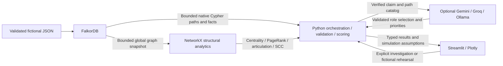

# BlastRadius AI

Trace a fictional cloud outage from a shared dependency to the customers it can affect.

## Problem and solution

A failed dependency can disrupt services and customer workflows several hops away.
BlastRadius AI investigates those relationships in FalkorDB, returns exact paths,
and presents an explainable heuristic exposure score and graph-grounded briefing.
Its simulated cascade compares fictional containment outcomes without infrastructure actions.

**Why FalkorDB:** bounded, parameterized Cypher retrieves changing dependency,
workflow, customer, owner, runbook and replica paths directly from the graph.
NetworkX computes structural metrics from a bounded snapshot. SQL could express
recursive analysis too; the advantage here is relationship/path clarity, not a
claim that a relational database cannot do it.

## Try the online demo in three clicks

1. **Run Token Vault Demo** — compute Critical severity, the risk score, potentially
   affected services/customers and maximum evidence hop depth.
2. **View FalkorDB Evidence** — open safe executed Cypher receipts, timings, limits
   and a service → workflow → customer path with supporting edge details.
3. **Simulate Mitigation** — build the fictional cascade and containment comparison
   using the existing simulator. Reset/replay controls remain available.

The Token Vault demo always uses deterministic reporting; no API key is required.
Optional Gemini, Groq and Ollama briefings do not determine infrastructure facts.

## Start locally

From the repository root, with Python 3.12 and Docker Desktop running:

```zsh
python3.12 -m venv .venv
source .venv/bin/activate
python -m pip install -r requirements-dev.txt
test -e .env || cp .env.example .env
docker compose up -d --wait
python -m src.health
python -m src.seed
python -m src.seed --validate
python -m streamlit run app.py
```

Open http://127.0.0.1:8501. Normal seeding merges the fictional fixture without
resetting the graph; use a dedicated demo graph, not valuable data.
[Complete macOS setup and troubleshooting](docs/setup.md).

> BlastRadius AI is a local hackathon demonstration using fictional infrastructure, incidents, organizations and customers. It does not connect to live cloud systems, confirm causation, or execute real remediation.

Simulation timestamps and recovery assumptions are fictional; software benchmarks
measure local execution only. Risk is heuristic, causes are candidates, and a
declared replica does not prove failover readiness.


Real Brave captures: [overview](docs/assets/dashboard-overview.png),
[native query receipts](docs/assets/falkordb-evidence.png),
[customer path](docs/assets/customer-evidence.png), and
[fictional cascade](docs/assets/cascade-simulation.png).
[Capture status and remaining narrow-layout checks](docs/screenshots.md).

Built for **Graph Hacks · Connected Data · WeMakeDevs and FalkorDB**.
[Native query semantics, fallback and limits](docs/native-falkordb.md).

## Major features

Measured on the local 54-node / 141-edge graph: native blast query round-trip
median **3.753 ms**, full no-LLM pipeline median **32.781 ms** (20 iterations,
2 warm-ups; cached global snapshot; excludes UI rendering and startup).
[Method, p95, raw samples and limitations](docs/benchmark.md). Not a production benchmark.

- Typed exact/fuzzy component discovery and upstream/downstream evidence.
- Required versus optional dependencies, cycle-safe bounded traversal.
- Customer, business-workflow, region, owner and runbook impact.
- Explainable bottleneck metrics, root-cause candidates and exposure scoring.
- Native Cypher receipts and a graph-versus-direct-lookup comparison.
- Gemini, Groq, optional Ollama, and deterministic graph-grounded briefings.
- Role-specific incident-commander, owner and business-stakeholder narratives.
- Deterministic cascade timeline and before/after fictional mitigation comparison.
- Plotly evidence graph, accessible labels, JSON exports and safe empty states.

## The memorable example: Token Vault

Token Vault is shared by Authentication, Payment and Subscription operations.
One recorded customer chain is:

**Token Vault → Subscription Service → renewal workflow → Atlas**

The dependency arrow here shows failure propagation; stored dependency edges
point from consumer to provider. The UI retains that distinction and cites exact
relationship types. Responsible teams are separate owner branches—not invented
customer-to-team edges. The fictional Token Vault failure scores Critical in the
seeded demonstration, while optional analytics failure scores lower.

## Architecture



The LLM never discovers infrastructure facts or executes queries/remediation.
A deterministic report is always available. Native retrieval and global analytics
are different layers; the UI identifies the reasoning engine used for each result.

## Knowledge graph

The fictional fixture contains **54 nodes and 141 relationships**:

| Labels | Count |
|---|---:|
| Service / Database / Queue | 18 / 5 / 3 |
| Region / Customer / Team | 3 / 6 / 6 |
| API / BusinessFlow / Runbook / Incident | 3 / 4 / 5 / 1 |

Every entity also has a Component label and a stable ID. Properties include name,
status, criticality, environment, description, tier, region and last_checked.
Dependency edges retain required, criticality, latency_ms, status and timestamps.

| Relationship | Stored direction |
|---|---|
| DEPENDS_ON, CALLS, READS_FROM, WRITES_TO, PUBLISHES_TO, CONSUMES_FROM | Consumer → provider |
| DEPLOYED_IN / OWNED_BY / HAS_RUNBOOK | Component → region / team / runbook |
| SUPPORTS / USED_BY | Service → workflow / workflow → customer |
| AFFECTS / REPLICATES_TO | Incident → component / source → declared replica |

[Full schema, integrity rules and import limitations](docs/graph-schema.md).

## Native FalkorDB queries

Representative downstream traversal (the application validates depth 1–8 before
inserting that integer; all lookup values and limits remain parameters):

```cypher
MATCH p=(a:Component)<-[:CALLS|CONSUMES_FROM|DEPENDS_ON|PUBLISHES_TO|READS_FROM|WRITES_TO*1..6]-(b:Component)
WHERE a.id = $component_id
AND all(n IN nodes(p) WHERE single(m IN nodes(p) WHERE m.id = n.id))
RETURN p ORDER BY length(p) LIMIT $limit
```

Example parameters: component_id = "vault", limit = 501. One extra row detects
truncation; at most 500 paths are accepted per operation.

```cypher
MATCH (s:Component)-[:OWNED_BY]->(t:Team)
WHERE s.id = $component_id
RETURN s.id, t.id

MATCH (s:Component)-[:DEPLOYED_IN]->(r:Region)
WHERE s.id = $component_id
RETURN s.id, r.id, r.status
```

Cross-domain queries continue technical paths through workflow and customer
relationships. [Actual native operations and server workaround](docs/native-falkordb.md).

## NetworkX algorithms and heuristic risk

Degree/in-degree/out-degree, betweenness, PageRank, undirected articulation points,
strongly connected components, directed shortest paths and critical-path ranking
support the investigation. All original parallel edges remain in evidence:
required, higher-criticality and explicitly unhealthy edges win evidence ties.

The exposure score is deterministic, **not an outage probability**:

| Factor | Weight |
|---|---:|
| Blast radius / customer impact / workflow impact | 20 / 20 / 15 |
| Dependency criticality / betweenness | 15 / 10 |
| Articulation / required-dependency share / health | 5 / 5 / 10 |

Normalized factors sum to at most 100; declared healthy alternatives subtract up
to 15 points. Optional-only exposure receives reduced weight. Low <25, Medium
<50, High <75, Critical ≥75. Every contribution is displayed.
[Exact formula and limitations](docs/analytics-and-reports.md).

## AI grounding and privacy

Reports retain validated facts, candidate hypotheses, paths and unknowns.
Providers select known claim IDs to build role-specific briefings and prioritize
approved responses/questions. Fictional mitigation comparisons use supplied
simulator scores; providers cannot invent entities, measurements or numbers.
Unsupported output is discarded and the deterministic template is used.

This is constrained, graph-grounded briefing—not autonomous causal diagnosis.
Incident notes are analyst context and do not enter provider prompts. Graph
evidence does leave the machine when you explicitly enable a cloud provider.
The regional envelope view does not call a provider.

## Simulated cascade

Play, pause, step and reset a fictional event timeline. Required failures
propagate; optional dependencies degrade or stop propagation. Declared alternate
deployments can support assumed failover, but do not prove readiness or capacity.
Compare fictional isolation, read-only mode or other eligible actions.

No simulation changes the seeded graph or executes infrastructure actions.
[Simulation assumptions and controls](docs/simulation.md).

## Technology and repository

Python 3.12; FalkorDB/Cypher; Docker Compose; NetworkX/SciPy; Pydantic;
python-dotenv; Streamlit; Plotly; pytest/coverage; Ruff; Bandit; pip-audit.
Providers use direct HTTP adapters. No OpenAI service/SDK, Neo4j or LangChain.

```text
app.py                    Thin entry point
src/native_queries.py     Native typed path retrieval and query receipts
src/graph_queries.py      Bounded Python reference/fallback operations
src/investigator.py       Structured incident orchestration
src/analytics.py          NetworkX metrics and explained scoring
src/reports.py            Grounded report validation and provider routing
src/briefings.py           Role narratives and fictional comparison evidence
src/simulator.py          In-memory deterministic rehearsal
src/dashboard_*.py        Dashboard services and presentation
src/evidence_ui.py        Visible graph advantage and receipts
src/visualization.py      Plotly presentation
data/topology.json        Validated fictional import fixture
tests/                    Unit, UI, provider and opt-in integration tests
docs/                     Setup, schema, assumptions and verification
```

## Installation, Docker and seeding

See [canonical macOS setup](docs/setup.md) for prerequisites, Apple Silicon/PATH
instructions, run-only versus development installation, and port troubleshooting.

```zsh
python3.12 -m venv .venv
source .venv/bin/activate
python -m pip install --upgrade pip
python -m pip install -r requirements-dev.txt
test -e .env || cp .env.example .env
docker compose up -d --wait
python -m src.health
python -m src.seed
python -m src.seed --validate
python -m streamlit run app.py
```

Compose pins the FalkorDB image, binds ports 6379/3000 to loopback, uses a named
persistent volume, restart policy and health check. FalkorDB Browser is optional.
Stop with `docker compose down`; do not add `-v` to retain data. Redis snapshots
are not a production backup. No reset is needed. Explicit reset requires the
configured graph name and deletes Component data; avoid it for normal use.

## Environment configuration

Copy .env.example only when .env is absent. Process environment overrides file
settings. Keys are read **only** from process environment; dotenv interpolation
is disabled.

| Setting | Default / purpose |
|---|---|
| FALKORDB_HOST / PORT / GRAPH | localhost / 6379 / blast_radius |
| LLM_PROVIDER | deterministic; alternatively gemini, groq, ollama |
| GEMINI_API_KEY / GEMINI_MODEL | Key absent / gemini-2.5-flash |
| GROQ_API_KEY / GROQ_MODEL | Key absent / llama-3.3-70b-versatile |
| OLLAMA_BASE_URL / OLLAMA_MODEL | http://localhost:11434 / qwen3:8b |
| LLM_FALLBACK_ENABLED | false; cross-provider fallback requires true |
| LLM_TIMEOUT_SECONDS | 20; bounded maximum 120 |

### Gemini / Groq: manual opt-in only

Privately export your own key; do not put it in Git or screenshots. In zsh,
`read -rs "GEMINI_API_KEY?Gemini API key: " && export GEMINI_API_KEY` reads without
putting the typed key in shell history. Use the analogous GROQ_API_KEY command
for Groq.

```zsh
LLM_PROVIDER=gemini python -m src.reports --component 'Token Vault' --status failed --json
LLM_PROVIDER=groq python -m src.reports --component 'Token Vault' --status failed --json
```

These commands send fictional graph evidence externally and consume provider
quota. They are not run by tests. Inspect actual provider/model and warnings:
a successful HTTP response is not enough if grounding validation falls back.
Cloud-provider success is not claimed until an authorized real call passes.

### Optional local Ollama

Install/start Ollama separately, then:

```zsh
ollama pull qwen3:8b
LLM_PROVIDER=ollama python -m src.reports --component 'Token Vault' --status failed --json
```

HTTP Ollama URLs are loopback-only. A configured remote HTTPS endpoint receives
the evidence; treat that as an explicit privacy choice. Local model operation
requires available memory and is not verified merely by configuring its URL.

### Deterministic fallback

```zsh
python -m src.reports --component 'Token Vault' --status failed --deterministic
```

No keys, model download or internet are needed after dependencies/image exist.

## Running and testing

```zsh
python -m pip install -r requirements-dev.txt
python -m pytest
FALKORDB_INTEGRATION=1 python -m pytest
ruff check .
ruff format --check .
python -m compileall -q src tests scripts app.py
bandit -r src scripts -q
python scripts/check_secrets.py
python scripts/check_secrets.py --history
python -m pip check
pip-audit --cache-dir .audit-cache --progress-spinner off
```

Coverage is enforced at 80%. Provider calls are mocked. Integration tests require
the seeded local graph; importer tests create uniquely named disposable graphs.
[Security boundaries](docs/hardening.md) and [phase baseline](docs/baseline-audit.md).

[Latest technical audit: 90/100 internal assessment](docs/final-audit.md).

[Development history](docs/development-history.md) and
[conceptual reference review](docs/reference-review.md) keep phase records and
external research separate from product claims. The latest benchmark also reports
cached Python fallback costs; it does not establish a native database speedup.

[CI workflow and manual repository choices](docs/repository-quality.md): quality
checks run on push/pull request; disposable FalkorDB integration is manual opt-in.
The workflow exists locally; no GitHub execution or passing badge is claimed.

[Final clean-room results](docs/final-validation.md): archived source and a fresh
Python environment passed **166 tests with 88.97% statement coverage**. All five
scenario scores reproduced; live provider and manual viewport checks remain pending.

## Demo scenarios

| Scenario | What it demonstrates |
|---|---|
| Token Vault timeout | Shared critical dependency and hidden customer exposure |
| Orders Database latency | Different multi-hop downstream routes |
| Mumbai outage | Deployment exposure; **worst-case component-envelope score**, not a regional probability |
| External payment API degradation | External dependency and customer workflow exposure |
| Optional analytics failure | Reduced severity relative to required critical dependencies |

Start with Token Vault, show one customer path and its Cypher, replay the cascade,
then compare fictional containment. Do not tour all nine tabs.

[Three-minute script, pitches, 15 judge answers and failure backups](docs/demo-script.md).
[Submission-day checklist](docs/submission-checklist.md).

## Screenshots and recording

Real captures are pending. Required views: landing, Token Vault, graph, customer
path, bottlenecks, score breakdown, Cypher receipts, timeline, mitigation comparison,
deterministic fallback, wide and narrow layouts. Store sanitized captures under
docs/assets/. Never include keys, private paths or account details. No AI-generated
image should be presented as an application screenshot.

## Security and current limitations

Local single-operator demo only; services bind to loopback. No public
authentication, cloud connectors, live telemetry or remediation executor.
Do not expose Redis, Browser or Streamlit directly to the internet.

Paths are bounded to 1–8 dependency hops, 500 returned paths per operation,
2,000 nodes and 10,000 relationships; timeout/truncation can make evidence partial.
Native ordinary traversal does not require a full export; global analytics does.
Snapshots can become stale. Seeding is sequential/idempotent, not transactional;
the ID index is not a uniqueness constraint. Topology changes require refresh.

Risk weights are heuristic, root causes are candidates, and alternate deployments
do not prove failover capacity. Simulations assume a fictional healthy baseline
and deterministic presentation timings. No causal diagnosis or measured recovery
is claimed. Python advisory checks do not certify container OS vulnerabilities.

## Future production integration

Possible future work—not implemented: read-only AWS/Azure/GCP inventory import,
OpenTelemetry freshness signals, versioned topology snapshots, calibrated risk
weights, verified failover metadata, authenticated multi-tenant access, TLS and
managed secrets. Real ingestion would need explicit permissions and privacy review.

## Troubleshooting

[Canonical troubleshooting table](docs/setup.md#troubleshooting) covers Docker,
occupied ports, empty graphs, provider quota/authentication, Ollama, image pulls,
coverage-plugin installation and stale snapshots. Always try health and graph
validation before changing data. Never automatically kill an unrelated process.

## Team and license

**Team name:** [confirm before submission].  
**Contributors and roles:** [confirm names and contributions before submission].  
**Recording/submission URLs:** [add manually after review].

Licensed under the actual repository's [MIT License](LICENSE). Copyright and
license attribution remain unchanged. No external accounts, publication or
deployment are required to run this local demonstration.
